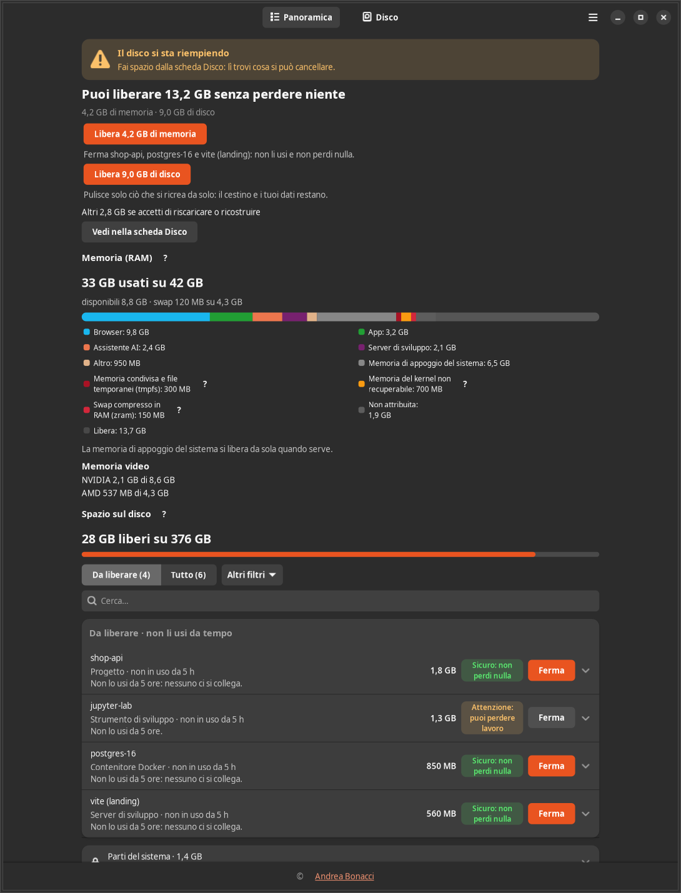
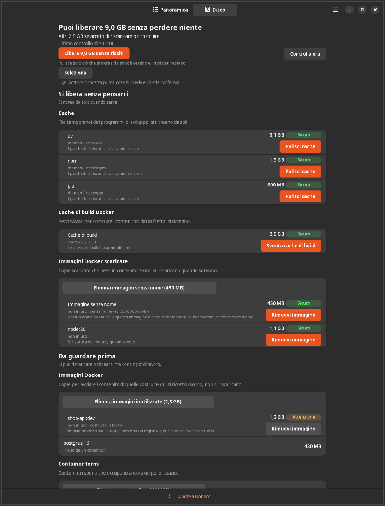

[English](README.md) | **Italiano**

<div align="center">


# Where Is My Memory

Un'app per la barra di Ubuntu che mostra cosa occupa RAM e disco, raggruppato per progetto,
e lo libera solo dopo la tua conferma.

[](https://github.com/AndreaBonn/where-is-my-memory/actions/workflows/ci.yml)
[](https://github.com/AndreaBonn/where-is-my-memory/actions/workflows/ci.yml)
[](https://github.com/AndreaBonn/where-is-my-memory/actions/workflows/ci.yml)
[](https://github.com/AndreaBonn/where-is-my-memory/releases/latest)
[](LICENSE)
[](docs/user-guide.it.md#requisiti)

</div>

Dopo qualche giorno di lavoro il computer rallenta e la RAM è quasi finita, anche se sembra
che non ci sia molto aperto. Quasi sempre la causa è qualcosa rimasto acceso: container
Docker di un progetto chiuso da giorni, server di sviluppo, sessioni di terminale,
programmi pesanti dimenticati in secondo piano.

Where Is My Memory mostra cosa occupa memoria e disco, raggruppato per progetto e per tipo,
e distingue ciò che è in uso da ciò che è acceso ma fermo. Per ogni gruppo dice quanta
memoria recupereresti e da quanto tempo non succede niente. Vive nella barra in alto del
desktop GNOME e manda una notifica quando un gruppo resta fermo da ore o quando memoria o
disco stanno finendo. Può fermare e pulire ciò che non serve, ma solo dopo un dialogo che
elenca cosa succede e quanto spazio torna libero.

## In pratica



Le immagini usano dati di prova, non quelli di un computer reale.

## Cosa fa

- Raggruppa processi e container per progetto, applicazione e tipo, con la memoria che ogni
  gruppo occupa e quella che recupereresti.
- Distingue ciò che è in uso da ciò che è fermo usando CPU, rete e, su X11, la finestra in
  primo piano, e mostra il motivo di ogni giudizio.
- Elenca cosa si può liberare sul disco: cache dei gestori di pacchetti, immagini,
  container, volumi e cache di build di Docker, cartelle di dipendenze di progetti vecchi,
  modelli AI, emulatori Android, browser di Playwright, prodotti JetBrains e cestino.
- Classifica ogni azione come Sicuro, Attenzione o Pericolo. Le azioni Pericolo chiedono di
  scrivere il nome del bersaglio prima di abilitare il pulsante.
- Manda notifiche di GNOME per i gruppi fermi da molto e per memoria o disco quasi pieni,
  al massimo 3 in un'ora.
- Stampa un riepilogo dal terminale con `wimm status`, anche via SSH.
- Interfaccia in italiano e in inglese.

Mentre è in funzione non usa mai `sudo`, non forza mai da sola la chiusura di un programma
e non cancella niente senza la tua conferma.

## Installazione

Requisiti: Ubuntu 24.04 con GNOME. Docker o Podman solo se vuoi gestire anche i container.

1. Scarica `where-is-my-memory_1.1.0_all.deb` dall'[ultima
   release](https://github.com/AndreaBonn/where-is-my-memory/releases/latest).

2. Installalo dalla cartella in cui l'hai salvato:

   ```bash
   sudo apt install ./where-is-my-memory_1.1.0_all.deb
   ```

3. Esci dalla sessione e rientra, oppure avvialo subito:

   ```bash
   wimm --background
   ```

`apt` installa da solo le librerie necessarie. La guida completa, con ogni vista, le
preferenze e le risposte alle domande più comuni, è in
[docs/user-guide.it.md](docs/user-guide.it.md).

## Uso

| Comando | Cosa fa |
|---|---|
| `wimm` | apre la finestra |
| `wimm --background` | parte con la sola icona nella barra, come al login |
| `wimm status` | stampa memoria, pressione di memoria, i 5 gruppi più grandi e lo spazio libero, poi esce |
| `wimm status --json` | lo stesso in JSON |
| `wimm --version` | stampa la versione |

La finestra ha due schede. Panoramica elenca i gruppi e quanto puoi liberare senza perdere
niente; Disco elenca cosa si può liberare sul disco, in tre livelli di rischio.



## Sviluppo

Requisiti: Ubuntu 24.04, Python di sistema 3.12 o successivo, [uv](https://docs.astral.sh/uv/),
`make` e questi pacchetti apt:

```bash
sudo apt install python3-gi python3-psutil python3-docker python3-pil gettext gir1.2-gtk-4.0 gir1.2-adw-1
```

L'ambiente virtuale usa il Python di sistema con `--system-site-packages`, perché GTK,
psutil e l'SDK di Docker arrivano da apt e non da PyPI
([ADR-002](docs/adr/ADR-002-python-di-sistema-e-moduli-apt.md)).

| Comando | Cosa fa |
|---|---|
| `make setup` | crea l'ambiente virtuale e sincronizza le dipendenze con uv |
| `make run` | avvia l'app in modalità sviluppo |
| `make test` | esegue i test senza integrazione, interfaccia e D-Bus, con copertura minima del 90% su `core` |
| `make test-all` | esegue tutti i test su display X e bus di sessione privati (serve Xvfb) |
| `make lint` | Ruff, formattazione, mypy e controllo delle traduzioni |
| `make audit` | bandit sui sorgenti e pip-audit sulle dipendenze di sviluppo |
| `make po` / `make mo` | aggiornano e compilano il catalogo inglese `po/en.po` |
| `make deb` | costruisce il pacchetto in `dist/` |
| `make test-deb` | installa il pacchetto in un container Ubuntu 24.04 e verifica installazione e rimozione |

Tutto gira in un solo processo GTK 4. `core` contiene funzioni pure senza accesso al
sistema; `collectors` leggono processi, container e disco; `service` conserva lo stato ed è
l'unico punto che esegue le azioni confermate; `ui` e `tray` mostrano i dati.

```text
src/wimm/
  core/        regole pure: raggruppamento, attività, rischio, pianificazione, testi
  collectors/  lettori di /proc, cgroup, Docker, cache, finestra in primo piano
  service/     stato, notifiche, esecutore delle azioni confermate, D-Bus
  ui/          finestra e dialoghi GTK 4 / libadwaita
  tray/        icona StatusNotifierItem e il suo menu
tests/         suite pytest, rispecchia src/wimm
packaging/     pacchetti Debian, RPM e Arch, pagina man
docs/          guida utente, ADR, note di sicurezza
```

La specifica di riferimento è `assets/SPECIFICHE.md`; gli scostamenti sono in
`docs/DEVIATIONS.md`. La CI (`.github/workflows/ci.yml`) esegue lint, test e controllo di
sicurezza a ogni push e aggiorna i badge di test e copertura su `main`.

## Sicurezza

Per segnalare una vulnerabilità, consulta [SECURITY.it.md](SECURITY.it.md).

## Licenza

Distribuito con licenza GNU General Public License v3.0 o successiva. Vedi
[LICENSE](LICENSE).

## Autore

Andrea Bonacci ([AndreaBonn](https://github.com/AndreaBonn)).

## Sostieni il progetto

<div align="center">

Where Is My Memory è gratuita. Se ti è utile e vuoi contribuire, puoi lasciare un'offerta
tramite PayPal. L'importo lo scegli tu ed è del tutto facoltativo.

[](https://paypal.me/AndreaBonacci19)

</div>

Se questo progetto ti è stato utile, lascia una
[stella su GitHub](https://github.com/AndreaBonn/where-is-my-memory): aiuta altri a
trovarlo.
