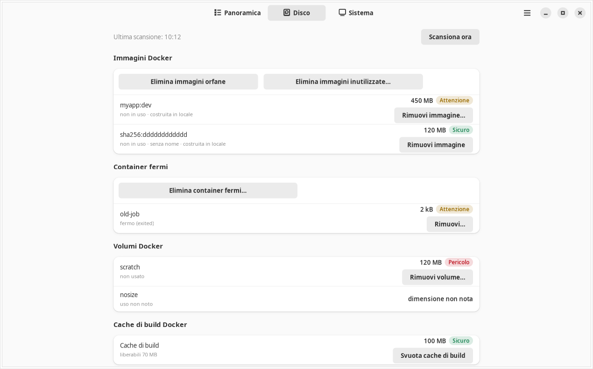
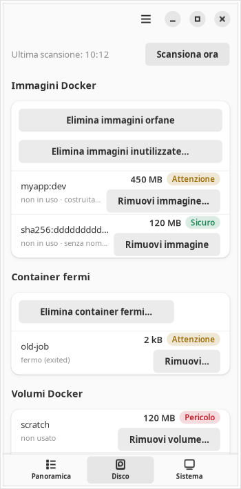

# where-is-my-memory

Dopo qualche giorno di lavoro il computer rallenta e la RAM è quasi finita, anche se
sembra che non ci sia molto aperto. Quasi sempre la causa è qualcosa rimasto acceso:
container Docker di un progetto chiuso da giorni, server di sviluppo, sessioni di
terminale, programmi pesanti dimenticati in secondo piano.

where-is-my-memory per Ubuntu mostra cosa occupa la memoria, raggruppato per progetto e
per tipo, e distingue ciò che è in uso da ciò che è acceso ma fermo. Per ogni gruppo dice
quanta RAM si libererebbe e da quanto tempo non succede niente. Vive nella barra in alto
del desktop, con un'icona sempre visibile, e ti avvisa con una notifica quando un gruppo
resta fermo da ore o quando RAM o disco stanno finendo.

Può anche chiudere ciò che non serve, ma solo se glielo chiedi tu: ogni azione passa da
una finestra di conferma che elenca cosa succede e quanto spazio si libera. Non usa
`sudo`, non forza mai la chiusura di un programma da sola e non cancella niente senza
conferma.



Le immagini di questo documento usano dati di prova, non quelli di un computer reale.

## Requisiti

- Ubuntu 24.04 con desktop GNOME
- Docker, solo se vuoi vedere e gestire anche i container

## Installazione

Il pacchetto si costruisce dalla cartella del progetto che hai ricevuto. Apri un terminale
in quella cartella ed esegui i comandi uno alla volta.

1. Installa gli strumenti per costruire il pacchetto:

   ```bash
   sudo apt install make git
   ```

2. Il pacchetto riporta chi l'ha costruito. Se non hai mai configurato `git`, indica nome
   ed email (servono solo a questo):

   ```bash
   git config --global user.name "Nome Cognome"
   git config --global user.email "nome@esempio.it"
   ```

3. Costruisci il pacchetto. Il file nasce nella cartella `dist/` ed ha la forma
   `where-is-my-memory_<versione>_all.deb`; il comando stampa il percorso esatto
   alla fine:

   ```bash
   make deb
   ```

4. Installalo, con il nome stampato dal comando precedente (per la versione 0.1.0 è
   quello qui sotto):

   ```bash
   sudo apt install ./dist/where-is-my-memory_0.1.0_all.deb
   ```

`apt` installa da solo le librerie necessarie. Come componenti consigliati aggiunge anche
l'estensione AppIndicator per l'icona nella barra, gli strumenti per Docker e `x11-utils`
(serve a capire quale finestra è in primo piano su X11, vedi le domande frequenti).

## Primo avvio

Esci dalla sessione e rientra: l'app parte da sola al login, con l'icona nella barra e la
finestra chiusa. Se non vuoi riavviare la sessione, lancia da terminale:

```bash
wimm --background
```

Il comando `wimm`, senza opzioni, apre direttamente la finestra, e si trova anche tra le
applicazioni con il nome "Where Is My Memory". `wimm --version` stampa la versione.

Se dopo il login non vedi né l'icona né la finestra, l'app non è partita: lancia
`wimm --background` da terminale. Se invece la finestra si apre con un avviso in alto,
manca l'estensione per l'icona (vedi le domande frequenti).

Nei primi minuti la Panoramica mostra "Raccolta dati in corso": servono alcuni campioni
per giudicare se un gruppo è in uso. La prima scansione del disco parte poco dopo
l'avvio, e puoi anticiparla dalla vista Disco con "Scansiona ora".

## Uso

La finestra ha in alto tre schede, Panoramica, Disco e Sistema, e sopra l'elenco un
riepilogo di RAM e disco con la quantità "Recuperabile ora".

### Panoramica

Un gruppo per riga: un progetto, un'applicazione, un container o un insieme di processi
legati tra loro. Ogni riga riporta:

- nome, categoria (Progetto, Container, Dev server, Browser, Terminale e così via) e stato:
  in uso, inattivo da una certa durata, oppure "attività non misurabile";
- il motivo dello stato, per esempio "nessuna connessione in ingresso e CPU media 0,1%
  negli ultimi 30 minuti";
- la RAM occupata e quella recuperabile, il badge di rischio e il pulsante dell'azione
  principale ("Ferma", "Chiudi…" e così via).

Espandendo la riga vedi i singoli membri, ciascuno con le sue azioni, e i pulsanti
"Silenzia" (1 h, 24 h, 7 giorni) e "Ignora". Il clic destro offre "Copia comando",
"Apri cartella" e "Copia PID". Sopra l'elenco ci sono i filtri e la ricerca (`Ctrl+F`);
`F5` aggiorna i dati e `Ctrl+,` apre le Preferenze.

"Ferma tutti gli inattivi sicuri" ferma in un colpo solo i gruppi inattivi con rischio
Sicuro. Nel dialogo puoi togliere le singole voci prima di confermare.

### Disco

Mostra cosa si può recuperare sul disco, con la data dell'ultima scansione e il pulsante
"Scansiona ora". La scansione automatica si ripete ogni 6 ore.

- Docker: immagini (in uso, senza nome, costruite in locale), container fermi, volumi non
  usati e cache di build.
- Cache dei gestori di pacchetti, come uv, npm e pip.
- Cartelle di dipendenze (`node_modules`, `.venv`) di progetti fermi da oltre 90 giorni,
  cercate nelle cartelle indicate nelle Preferenze. La cartella di partenza predefinita è
  `~/Documenti/00_Lavoro`: se i tuoi progetti stanno altrove, aggiungila lì.
- Cestino.

Ogni sezione mostra le prime 200 voci per dimensione, con un contatore per le altre. Se
Docker non è disponibile, il messaggio compare solo nella sezione Docker e il resto della
vista funziona.

### Sistema

I processi che servono al desktop e al sistema, solo elencati e mai modificabili, con il
motivo per cui sono protetti.

### Rischio e conferme

Ogni azione ha un badge che dice cosa si rischia. Il badge riporta sempre anche il testo,
non solo il colore.

| Badge | Significato | Cosa chiede l'app |
|---|---|---|
| Sicuro | Reversibile: nessun dato o lavoro perso, si riavvia con lo stesso comando. | Un dialogo con l'anteprima e un clic sul pulsante dell'azione, per esempio "Ferma". |
| Attenzione | Può andare perso uno stato non salvato, una sessione o un lavoro da rifare (reinstallare dipendenze, ricostruire un'immagine). | Un dialogo con le conseguenze in evidenza e il pulsante di conferma in rosso. |
| Pericolo | Perdita di dati irreversibile: volumi Docker, cestino, spegnere un progetto Compose con i suoi volumi, forzare la chiusura di un programma con documenti o di un database. | Un dialogo che chiede di scrivere il nome del bersaglio (il volume, il progetto, "Cestino") e abilita il pulsante solo quando coincide. |

Il rischio dipende dalla coppia elemento e azione: fermare un container con un volume è
Sicuro, perché i dati restano nel volume; rimuovere il volume è Pericolo. Se tra il
momento in cui guardi e quello in cui confermi qualcosa cambia (un processo finito, un
container ripartito), l'app ricalcola e ti mostra di nuovo il dialogo, invece di agire su
una situazione diversa da quella che hai visto.

I programmi vengono fermati con un segnale di chiusura normale. Se uno non risponde entro
5 secondi, l'esito lo segnala e offre "Forza chiusura", che è un'azione a parte, con la
sua conferma. Su Firefox, per esempio, chiudere in questo modo non salva la sessione
all'uscita: alla riapertura le schede tornano dal salvataggio automatico, che può essere
indietro di qualche secondo.

### Notifiche

Arrivano come notifiche di GNOME, al massimo 3 in un'ora (oltre, si raggruppano in una
sola), in due casi:

- un gruppo di tipo Progetto, Container, Dev server o Processo di sviluppo è inattivo da
  almeno 2 ore e libererebbe almeno 200 MB. Ogni notifica ha i pulsanti per aprire il
  gruppo e per silenziarlo per 24 ore;
- RAM disponibile o spazio libero sul disco sotto il 10%. Queste partono anche a limite
  raggiunto, al più una all'ora per tipo.

Applicazioni con documenti e agenti AI non generano notifiche di inattività, a meno che tu
non le attivi nelle Preferenze. Soglie, durate e categorie si regolano da Preferenze,
nel menu della finestra, che contiene anche "Silenzia 1 h", "Info" ed "Esci".

### L'icona nella barra

Un clic sinistro apre la finestra, o la porta davanti se è già aperta. Un clic destro apre
un menu con il riepilogo di RAM e disco, fino a 5 gruppi inattivi (un clic su un gruppo
apre la finestra su quel gruppo), "Silenzia notifiche per 1 h" ed "Esci".

Accanto all'icona compare un testo come "4,2 GB inattivi": è la memoria che si libererebbe
fermando ciò che non viene usato. Sotto i 100 MB il testo non c'è. Il suggerimento che
compare passando il mouse sull'icona riporta RAM e disco in uso.

L'icona è un chip di memoria nel colore della barra, senza colori propri, e cambia
disegno in base alla risorsa più scarsa fra RAM disponibile e spazio libero sul disco:

| Icona | Aspetto | Significato |
|---|---|---|
| Normale | chip vuoto | Entrambe sopra il 15% |
| Avviso | chip con un punto esclamativo | La più scarsa è sotto il 15% |
| Critica | chip pieno con un punto esclamativo | La più scarsa è sotto il 10% |

I due limiti si cambiano da Preferenze. L'icona passa all'avviso anche se il monitoraggio
dà errore per 3 cicli di fila, e in quel caso la prima voce del menu lo dice.

Chiudere la finestra non ferma l'app, che continua a controllare. Per uscire del tutto
usa "Esci" dal menu dell'icona o dal menu della finestra.

## Domande frequenti

**Non vedo l'icona nella barra.**
Su Ubuntu l'icona dipende dall'estensione AppIndicator di GNOME. Se è disattivata o manca,
l'app funziona lo stesso: dopo circa 10 secondi dall'avvio apre la finestra anche con
`--background` e mostra in alto l'avviso "L'icona nella barra richiede l'estensione
AppIndicator di Ubuntu". Nelle Impostazioni di Ubuntu, alla voce Estensioni, puoi
attivarla; se non c'è, installa `gnome-shell-extension-appindicator` con `apt`. Quando
l'icona compare, l'avviso sparisce.

**Perché il browser mostra "attività non misurabile"?**
Dall'esterno non si può sapere se una scheda di Firefox o Chrome è in uso: il browser non
lo rende visibile. Per i browser, le applicazioni con interfaccia e i terminali l'app
guarda se la loro finestra è stata in primo piano di recente, e questo funziona solo su
X11. La memoria del browser è comunque conteggiata e visibile, ma per l'intero browser e
non scheda per scheda: la memoria di una singola scheda non è misurabile.

**Su Ubuntu 24.04 vedo "attività non misurabile" per molte app, anche non browser. Perché?**
Ubuntu 24.04 usa Wayland di default, e lì nessun programma può sapere quale finestra è in
primo piano. Il controllo del primo piano è quindi disattivato e i gruppi che dipendono da
quello restano in stato "non misurabile", senza che l'app indovini. Dev server, container
e processi di sviluppo si valutano con CPU e rete, e funzionano anche su Wayland. Chi vuole
il controllo del primo piano può scegliere "Ubuntu su Xorg" nella schermata di login.

**Un server avviato nel terminale di VS Code non compare tra i server di sviluppo. Perché?**
Per scelta di progetto, tutto ciò che discende da VS Code è contato dentro il gruppo
dell'editor. Un server lanciato dal terminale integrato quindi non ha un gruppo suo, ma la
sua memoria è inclusa in quella di VS Code. Lanciato da un terminale normale, appare come
server a sé.

**I programmi aperti in una sessione SSH risultano fra i processi di sistema. Perché?**
Per prudenza, i processi nati da una sessione SSH, o da un tmux avviato da lì, sono
trattati come protetti. Compaiono nella vista Sistema e non nella Panoramica.

**Mi serve per quello che lancio su altre macchine, collegato in remoto?**
No. L'app guarda solo il computer su cui è installata. Ciò che gira su un server remoto
occupa la memoria del server, non la tua, e l'app non lo vede.

**Cosa non fa mai l'app?**
Non chiede e non usa privilegi di amministratore (`sudo`). Non forza la chiusura di un
programma da sola: "Forza chiusura" parte solo se la scegli tu dopo un tentativo
fallito, con la sua conferma. Non cancella né ferma nulla senza una conferma tua nel
dialogo, nemmeno per le azioni segnate Sicuro. I processi del desktop e del sistema sono
protetti e non hanno azioni. Agisce solo sui processi e sui container del tuo utente.
Sul disco cancella solo ciò che la vista Disco elenca: le cartelle `node_modules` e
`.venv`, il contenuto delle cache dei gestori di pacchetti e del cestino, e immagini,
container fermi, volumi e cache di build di Docker. Non tocca mai il codice né gli altri
file dei tuoi progetti.

## I tuoi file

L'app salva solo dati suoi, nelle cartelle standard dell'utente:

| Cartella | Contenuto |
|---|---|
| `~/.config/where-is-my-memory/` | le preferenze |
| `~/.local/state/where-is-my-memory/` | dimensioni della finestra e altri dati di stato: da quanto tempo un gruppo è fermo, gruppi ignorati e silenziati |
| `~/.cache/where-is-my-memory/` | dati temporanei che l'app può ricostruire, come le dimensioni delle cartelle scansionate |

## Disinstallazione

```bash
sudo apt remove where-is-my-memory
```

I tuoi file nelle tre cartelle sopra restano anche con `apt remove` e con `apt purge`,
perché sono dati tuoi. Per cancellarli elimina le cartelle a mano. Se l'app è in
esecuzione, usa prima "Esci" dal menu dell'icona: `apt` non la ferma.

`apt remove` lascia il file di avvio automatico in `/etc/xdg/autostart/`, come per ogni
file di configurazione di sistema: `sudo apt purge where-is-my-memory` toglie anche quello.
Le librerie installate insieme all'app restano; `sudo apt autoremove` toglie quelle che
nessun altro programma usa.

## Per chi sviluppa

Servono Ubuntu 24.04, Python di sistema 3.12 o successivo, uv e i pacchetti apt
`python3-gi`, `python3-psutil`, `python3-docker`, `gir1.2-gtk-4.0`, `gir1.2-adw-1`.

| Comando | Cosa fa |
|---|---|
| `make setup` | crea l'ambiente virtuale e sincronizza le dipendenze con uv |
| `make test` | esegue i test senza integrazione, interfaccia e D-Bus |
| `make test-all` | esegue tutti i test su bus e display privati |
| `make lint` | controlla Ruff, formato e tipi con mypy |
| `make run` | avvia l'app in modalità sviluppo con `scripts/dev_run.sh` |
| `make deb` | costruisce il pacchetto in `dist/` |
| `make test-deb` | installa il pacchetto in un container Ubuntu 24.04 e verifica installazione e rimozione |

La specifica di riferimento è `assets/SPECIFICHE.md`; gli scostamenti rispetto ad essa
sono in `docs/DEVIATIONS.md`. Licenza GPL-3.0-or-later, testo completo in `LICENSE`.

Sulle schermate strette la vista Disco si riduce a una colonna:


