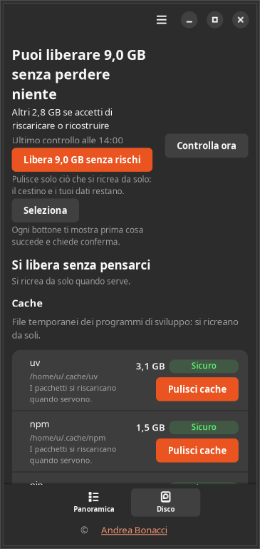
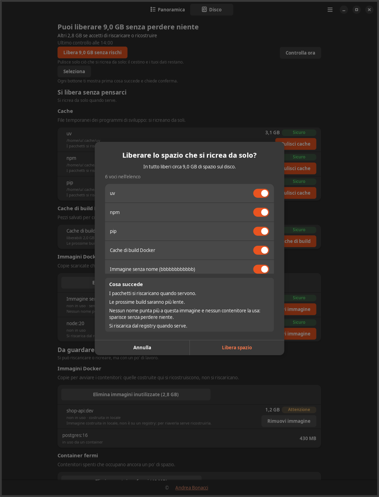

[English](user-guide.md) | **Italiano**

# Where Is My Memory: guida utente

Questa guida spiega come installare l'app da una release di GitHub, il primo avvio, ogni
parte della finestra e dell'icona nella barra, e come rimuovere l'app. Si riferisce alla
versione 1.1.0. Le immagini usano dati di prova, non quelli di un computer reale.

## Indice

- [Requisiti](#requisiti)
- [Installazione da una release](#installazione-da-una-release)
- [Primo avvio](#primo-avvio)
- [La scheda Panoramica](#la-scheda-panoramica)
- [La scheda Disco](#la-scheda-disco)
- [Rischio e conferme](#rischio-e-conferme)
- [Notifiche](#notifiche)
- [L'icona nella barra](#licona-nella-barra)
- [Preferenze](#preferenze)
- [Riga di comando](#riga-di-comando)
- [Domande](#domande)
- [I tuoi file](#i-tuoi-file)
- [Aggiornamento e disinstallazione](#aggiornamento-e-disinstallazione)

## Requisiti

- Ubuntu 24.04 con desktop GNOME
- Docker o Podman, solo se vuoi vedere e gestire anche i container

## Installazione da una release

1. Apri la [pagina delle release](https://github.com/AndreaBonn/where-is-my-memory/releases/latest)
   e scarica `where-is-my-memory_1.1.0_all.deb` dall'elenco Assets. Il browser lo salva in
   `~/Scaricati`.

2. Apri un terminale e spostati in quella cartella:

   ```bash
   cd ~/Scaricati
   ```

3. Installa il pacchetto. `apt` chiede la password e installa le librerie che servono
   all'app (GTK 4, libadwaita, psutil, l'SDK di Docker):

   ```bash
   sudo apt install ./where-is-my-memory_1.1.0_all.deb
   ```

   Il `./` iniziale serve: senza, `apt` cerca online un pacchetto con quel nome e non lo
   trova.

4. Controlla che sia andata a buon fine. Il comando stampa la versione:

   ```bash
   wimm --version
   ```

`apt` aggiunge anche tre componenti consigliati: l'estensione AppIndicator per l'icona
nella barra, gli strumenti a riga di comando di Docker e `x11-utils`, che l'app usa su X11
per sapere quale finestra è in primo piano. L'app chiede i privilegi di amministratore solo
per questa installazione, mai mentre è in funzione.

## Primo avvio

Esci dalla sessione e rientra: da quel momento l'app parte da sola a ogni login, con
l'icona nella barra in alto. Se non vuoi uscire dalla sessione adesso, avviala da
terminale:

```bash
wimm --background
```

La prima volta la finestra si apre da sola con un breve messaggio di benvenuto. Agli avvii
successivi resta chiusa. `wimm` senza opzioni apre direttamente la finestra, e l'app si
trova anche tra le applicazioni con il nome "Where Is My Memory".

Nei primi minuti la Panoramica mostra "Raccolta dati in corso…": servono alcuni campioni
per capire se qualcosa è in uso. Il primo controllo del disco parte due minuti dopo
l'avvio; puoi anticiparlo con "Controlla ora" nella scheda Disco.

L'interfaccia segue la lingua del sistema: italiano su un sistema in italiano, inglese
negli altri casi. Puoi cambiarla dalle Preferenze, alla voce "Lingua", senza riavviare.

## La scheda Panoramica


La finestra ha in alto due schede, Panoramica e Disco. La Panoramica si apre con una riga
di stato e un riquadro che somma quanto puoi liberare senza perdere niente, diviso fra
memoria e disco, con un pulsante per ciascuno:

- "Libera … di memoria" ferma i gruppi inattivi con rischio Sicuro, elencati nella riga
  sotto il pulsante.
- "Libera … di disco" pulisce ciò che si ricrea da solo, come le cache dei gestori di
  pacchetti e la cache di build di Docker. Il cestino e i tuoi dati restano.
- "Altri … se accetti di riscaricare o ricostruire" conta ciò che ti costa un nuovo
  download o una nuova build; "Vedi nella scheda Disco" lo mostra voce per voce.

Entrambi i pulsanti aprono prima il solito dialogo di conferma, dove puoi togliere le
singole voci.

Seguono il riepilogo della memoria, con una barra colorata per categoria e un "?" accanto
ai termini che richiedono una spiegazione (tmpfs, zram, memoria del kernel), la memoria
video di ogni scheda grafica e lo spazio sul disco.

Poi l'elenco dei gruppi. Un gruppo è un progetto, un'applicazione, un container o un
insieme di processi legati tra loro. Due interruttori scelgono cosa mostrare: "Da
liberare" (i gruppi inattivi che hanno un'azione, scelta predefinita) e "Tutto". "Altri
filtri" restringe l'elenco per tipo e rischio, e `Ctrl+F` cerca per nome. Ogni riga
riporta:

- nome, categoria (Progetto, Contenitore Docker, Server di sviluppo, Browser, Terminale e
  così via) e stato: in uso, inattivo da una certa durata, oppure "attività non
  misurabile";
- il motivo dello stato, per esempio "Non lo usi da 5 ore.";
- la memoria che recupereresti, il badge di rischio e il pulsante dell'azione principale
  ("Ferma", "Chiudi…");
- quando un gruppo continua a crescere, la sua crescita, per esempio "+620 MB in 2 h".
  Compare quando un gruppo cresce di almeno 256 MB e del 20% in almeno un'ora.

Espandendo la riga vedi i singoli membri, ciascuno con le sue azioni, e la riga "Non
avvisarmi per questo" con i pulsanti "1 ora", "1 giorno", "7 giorni" e "Mai più". Il clic
destro su una riga offre "Copia comando", "Apri cartella" e "Copia PID".

Dopo che hai fermato qualcosa, un messaggio in basso riporta quanto si è liberato. Per i
programmi offre anche "Riaccendi" e "Copia comando di riavvio". Il comando copiato viene
tolto dagli appunti dopo 60 secondi.

In fondo all'elenco, "Parti del sistema" raccoglie i programmi che servono al desktop e al
sistema. Sono elencati con il motivo per cui sono protetti e non hanno mai azioni: da qui
non puoi rompere niente.

`F5` aggiorna i dati e `Ctrl+,` apre le Preferenze.

## La scheda Disco


La scheda Disco mostra cosa si può liberare sul disco, con l'ora dell'ultimo controllo e
il pulsante "Controlla ora". Il controllo si ripete ogni 6 ore; l'intervallo si cambia
dalle Preferenze.

Le voci sono divise in tre livelli, uno per ogni grado di rischio, così ogni riga sta con
le altre che costano uguale da rimuovere:

| Livello | Rischio | Per esempio |
|---|---|---|
| Si libera senza pensarci | Sicuro | cache dei gestori di pacchetti (uv, npm, pip, yarn, pnpm, bun, Cargo, Go, conda), miniature, cache di build di Docker, immagini Docker scaricate che nessun container usa |
| Da guardare prima | Attenzione | immagini costruite da te, container fermi, cartelle di dipendenze di progetti vecchi, cache pesanti da riscaricare |
| Attenzione: cancella dati | Pericolo | volumi Docker, cestino, modelli AI ed emulatori |

Ogni riga mostra la dimensione, una parola breve sul rischio e, sotto il percorso, una
riga che dice cosa succede se la rimuovi: la stessa che leggerai nel dialogo di conferma.

**Cartelle di dipendenze.** `node_modules`, `.venv`, `venv`, `.tox`, `target`, `.gradle`,
`build`, `.next`, `.nuxt` e `vendor` di progetti fermi da oltre 90 giorni. L'app le cerca
nelle cartelle dei tuoi progetti: sceglie da sola le cartelle della home che contengono
repository git (come `~/code`, `~/projects`, `~/src`, `~/dev`, `~/git`, `~/workspace`,
`~/Documenti`). Se non ne trova lo dice e propone "Scegli una cartella". Puoi aggiungere
cartelle dalle Preferenze, in "Impostazioni avanzate", "Cartelle di sviluppo". Una
cartella che l'app rifiuta per sicurezza (un collegamento, una cartella di sistema, un
disco di rete, una cartella di un altro utente) compare lì con il motivo.

**Modelli ed emulatori.** Le cache più grandi si aprono in una riga per elemento, ciascuno
rimovibile da solo: modelli HuggingFace, modelli ollama (anche quelli di sistema),
emulatori Android (AVD) e pacchetti dell'SDK, browser di Playwright e prodotti JetBrains.
Gli elementi Android si rimuovono tramite gli strumenti di Android, e quelli JetBrains
lasciano le impostazioni dell'IDE. Mentre `ollama serve` è in funzione, un modello si
rimuove solo tramite quel server.

**Più voci insieme.** "Libera … senza rischi" libera in un solo dialogo tutte le voci del
primo livello. "Seleziona" aggiunge una casella a ogni riga; poi "Libera i selezionati"
libera insieme le voci spuntate, con ogni conseguenza elencata nel dialogo. Dopo ogni
rimozione l'app ricontrolla il disco.

Ogni sezione mostra le 200 voci più grandi e conta le altre. Se Docker non è disponibile,
lo dice solo la sezione Docker; il resto della scheda funziona.

Su una finestra stretta la scheda si riduce a una colonna:



## Rischio e conferme

Ogni azione ha un badge che dice cosa rischi. Il badge riporta sempre un testo, non solo
un colore.

| Badge | Significato | Cosa chiede l'app |
|---|---|---|
| Sicuro: non perdi nulla | Reversibile: nessun dato o lavoro perso, riparte con lo stesso comando. | Un dialogo con l'anteprima, poi un clic sul pulsante dell'azione, per esempio "Ferma". |
| Attenzione: puoi perdere lavoro | Può andare perso uno stato non salvato, una sessione o un lavoro da rifare (reinstallare dipendenze, ricostruire un'immagine). | Un dialogo con le conseguenze in evidenza e il pulsante di conferma in rosso. |
| Pericolo: cancella dati | Perdita di dati irreversibile: volumi Docker, cestino, spegnere un progetto Compose con i suoi volumi, forzare la chiusura di un programma con documenti o di un database. | Un dialogo che chiede di scrivere il nome del bersaglio (il volume, il progetto, il cestino). Il pulsante funziona solo quando il nome coincide. |



Il rischio dipende dalla coppia elemento e azione: fermare un container con un volume è
Sicuro, perché i dati restano nel volume; rimuovere il volume è Pericolo. Se tra il
momento in cui guardi e quello in cui confermi qualcosa cambia (un processo finito, un
container ripartito), l'app ripianifica e ti mostra di nuovo il dialogo, invece di agire
su una situazione che non hai visto.

I programmi vengono fermati con un segnale di chiusura normale. Se uno non risponde entro
5 secondi, l'esito lo segnala e offre "Forza chiusura", un'azione a parte con la sua
conferma. Su Firefox, per esempio, chiudere in questo modo non salva la sessione
all'uscita: alla riapertura le schede tornano dal salvataggio automatico, che può essere
indietro di qualche secondo.

## Notifiche

Arrivano come notifiche di GNOME, al massimo 3 in un'ora (oltre, si raggruppano in una
sola), in questi casi:

- un gruppo di tipo Progetto, Contenitore Docker, Server di sviluppo o Strumento di
  sviluppo è inattivo da almeno 2 ore e libererebbe almeno 200 MB. La notifica ha i
  pulsanti "Vedi e decidi" e "Non ora (24 h)";
- la memoria disponibile o lo spazio libero sul disco scende sotto il 10%, al più una
  volta all'ora per tipo;
- il sistema ha chiuso uno o più programmi perché la memoria era finita.

Le applicazioni con documenti e gli assistenti AI non mandano notifiche di inattività, a
meno che tu non le attivi nelle Preferenze. Il menu della finestra ha anche "Silenzia
1 h".

## L'icona nella barra

Un clic sinistro apre la finestra, o la porta davanti se è già aperta. Un clic destro apre
un menu con, in quest'ordine:

- "Apri Where Is My Memory";
- la memoria in uso, per esempio "Memoria usata: 48%";
- il disco, per esempio "Disco: 87% occupato (9,0 GB liberabili senza rischio)";
- "Da liberare:" e fino a 5 gruppi inattivi con la loro dimensione; un clic apre la
  finestra su quel gruppo;
- "Silenzia notifiche per 1 h" (oppure l'ora in cui finisce il silenzio);
- "Esci".

Accanto all'icona un testo come "4,2 GB da liberare" indica la memoria che recupereresti
fermando ciò che non usi. Sotto i 100 MB il testo non c'è. Passando il mouse sull'icona
compaiono memoria e disco in uso.

L'icona è un chip di memoria nel colore della barra, senza colori propri. Il disegno segue
la risorsa più scarsa fra memoria disponibile e spazio libero sul disco:

| Icona | Aspetto | Significato |
|---|---|---|
| Normale | chip vuoto | entrambe sopra il 15% |
| Avviso | chip con un punto esclamativo | la più scarsa è sotto il 15%, oppure il sistema è sotto pressione di memoria |
| Critica | chip pieno con un punto esclamativo | la più scarsa è sotto il 10%, oppure la pressione di memoria è forte |

I due limiti si cambiano dalle Preferenze. L'icona passa all'avviso anche se il
monitoraggio dà errore per 3 cicli di fila, e in quel caso la prima voce del menu lo dice.

Chiudere la finestra non ferma l'app, che continua a controllare. Per uscire del tutto usa
"Esci" dal menu dell'icona o dal menu della finestra.

## Preferenze

Si aprono dal menu della finestra o con `Ctrl+,`.

- "Quanti avvisi vuoi ricevere?" sceglie un'impostazione che regola tempo di inattività,
  dimensione e notifiche all'ora: "Pochi" (4 ore, 500 MB, 1 all'ora), "Normali" (2 ore,
  200 MB, 3 all'ora) o "Tanti" (1 ora, 100 MB, 6 all'ora).
- "Lingua" passa subito da Italiano a English e viceversa.
- "Programmi senza avvisi" elenca ciò che hai messo su "Mai più", così puoi riattivare gli
  avvisi.
- "Impostazioni avanzate" contiene ogni soglia una per una: limiti delle notifiche, limiti
  dell'icona, secondi prima che venga proposto "Forza chiusura", intervallo del controllo
  del disco, età e profondità delle cartelle di dipendenze, cartelle di sviluppo e il
  gruppo "Chiusura dei programmi".
- "Ripristina i valori consigliati" riporta tutto ai valori predefiniti.

## Riga di comando

| Comando | Cosa fa |
|---|---|
| `wimm` | apre la finestra |
| `wimm --background` | parte con la sola icona, come all'avvio automatico |
| `wimm --version` | stampa la versione |
| `wimm status` | stampa memoria, pressione di memoria, i 5 gruppi più grandi e lo spazio libero sul disco, poi esce |
| `wimm status --json` | lo stesso in JSON |

`wimm status` chiede i dati all'app in esecuzione, oppure prende un campione se l'app non
è avviata. Funziona anche da una sessione SSH.

## Domande

**Non vedo l'icona nella barra.**
Su Ubuntu l'icona dipende dall'estensione AppIndicator di GNOME. Se è disattivata o manca,
l'app funziona lo stesso: circa 10 secondi dopo l'avvio apre la finestra, anche con
`--background`, con un avviso in alto. "Come si attiva" mostra i passi per il tuo sistema.
Su Ubuntu:

```bash
gnome-extensions enable ubuntu-appindicators@ubuntu.com
```

Se l'estensione non è installata, installa `gnome-shell-extension-appindicator` con `apt`.
Quando l'icona compare, l'avviso sparisce.

**Perché il browser mostra "attività non misurabile"?**
Dall'esterno non si può sapere se una scheda di Firefox o Chrome è in uso: il browser non
lo rende visibile. Per i browser, le applicazioni con una finestra e i terminali l'app
guarda se la loro finestra è stata in primo piano di recente. La memoria del browser è
conteggiata e visibile, ma per l'intero browser e non scheda per scheda.

**Su Ubuntu 24.04 molte app mostrano "attività non misurabile". Perché?**
Ubuntu 24.04 usa Wayland di default, e su Wayland un programma non può sapere quale
finestra è in primo piano. Server di sviluppo, container e strumenti di sviluppo si
valutano con CPU e rete e funzionano anche su Wayland. Per il resto ci sono due strade:

- scegliere "Ubuntu su Xorg" nella schermata di login;
- attivare la piccola estensione di GNOME inclusa nel pacchetto (GNOME 46). Dice all'app
  quale programma è in primo piano e nient'altro. È sperimentale e l'app non la attiva mai
  da sola. Dopo aver installato l'app esci dalla sessione, rientra ed esegui:

  ```bash
  gnome-extensions enable wimm-focus@wimm.github.io
  ```

**Un server avviato nel terminale di VS Code non compare tra i server di sviluppo. Perché?**
Per scelta di progetto, tutto ciò che parte da VS Code è contato dentro il gruppo
dell'editor. Un server lanciato dal terminale integrato non ha un gruppo suo, ma la sua
memoria è inclusa in quella di VS Code. Lanciato da un terminale normale, compare da solo.

**I programmi avviati via SSH compaiono fra le parti del sistema. Perché?**
Per prudenza i processi nati da una sessione SSH, o da un tmux avviato da lì, sono
protetti per impostazione predefinita e compaiono in "Parti del sistema". Per gestirli
come gli altri, attiva "Gestisci anche i programmi lanciati via SSH" nelle Preferenze, in
"Impostazioni avanzate", "Chiusura dei programmi". Il server SSH e la shell di login
restano comunque protetti.

**Mi serve per quello che lancio su altre macchine, collegato in remoto?**
No. L'app guarda solo il computer su cui è installata. Ciò che gira su un server remoto
occupa la memoria del server, non la tua.

**Cosa non fa mai l'app?**
Non chiede e non usa privilegi di amministratore (`sudo`). Non forza mai da sola la
chiusura di un programma: "Forza chiusura" parte solo se la scegli tu dopo un tentativo
fallito, con la sua conferma. Non cancella né ferma nulla senza una tua conferma nel
dialogo, nemmeno per le azioni segnate Sicuro. I processi del desktop e del sistema sono
protetti e non hanno azioni. Agisce solo sui processi e sui container del tuo utente. Sul
disco cancella solo ciò che la scheda Disco elenca: cartelle di dipendenze, contenuto delle
cache dei gestori di pacchetti e del cestino, singoli modelli ed emulatori, e immagini,
container fermi, volumi e cache di build di Docker. Non tocca mai il codice né gli altri
file dei tuoi progetti.

## I tuoi file

L'app salva solo dati suoi, nelle cartelle standard dell'utente:

| Cartella | Contenuto |
|---|---|
| `~/.config/where-is-my-memory/` | le preferenze (`config.json`) |
| `~/.local/state/where-is-my-memory/` | dimensioni della finestra, da quanto tempo ogni gruppo è fermo, gruppi silenziati e ignorati, il log `wimm.log` |
| `~/.cache/where-is-my-memory/` | dati che l'app può ricostruire, come le dimensioni delle cartelle controllate |

## Aggiornamento e disinstallazione

Per aggiornare, scarica il nuovo `.deb` dalla pagina delle release e installalo con lo
stesso comando di [Installazione da una release](#installazione-da-una-release). Le
preferenze restano.

Per disinstallare, scegli prima "Esci" dal menu dell'icona (`apt` non ferma l'app), poi:

```bash
sudo apt remove where-is-my-memory
```

I tuoi file nelle tre cartelle sopra restano, con `apt remove` e con `apt purge`, perché
sono dati tuoi: se vuoi toglierli, elimina le cartelle a mano. `apt remove` lascia il file
di avvio automatico in `/etc/xdg/autostart/`, come per ogni file di configurazione di
sistema; `sudo apt purge where-is-my-memory` toglie anche quello. Le librerie installate
insieme all'app restano; `sudo apt autoremove` toglie quelle che nessun altro programma
usa.
