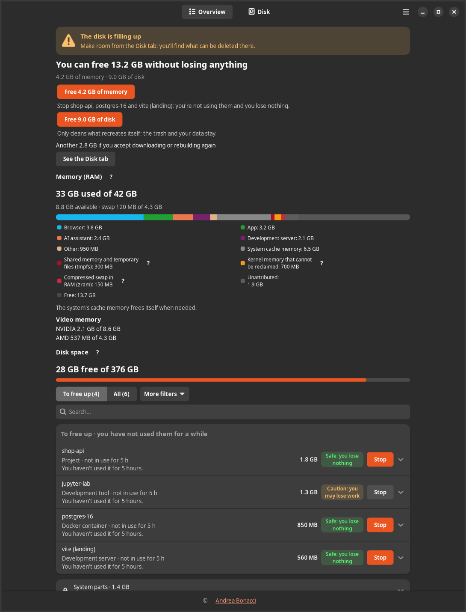
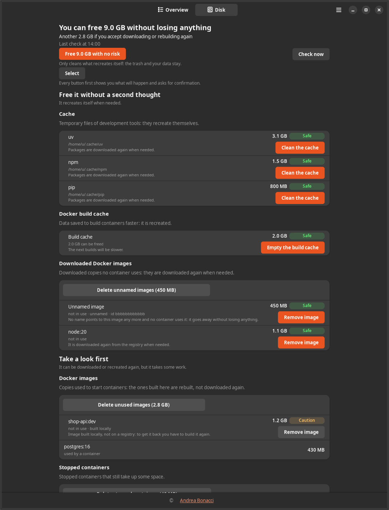
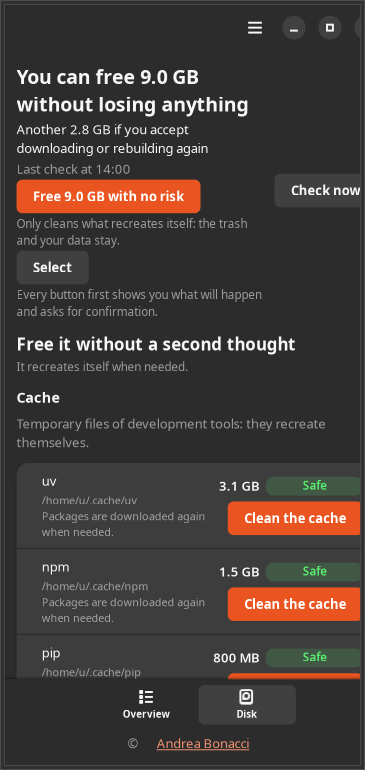
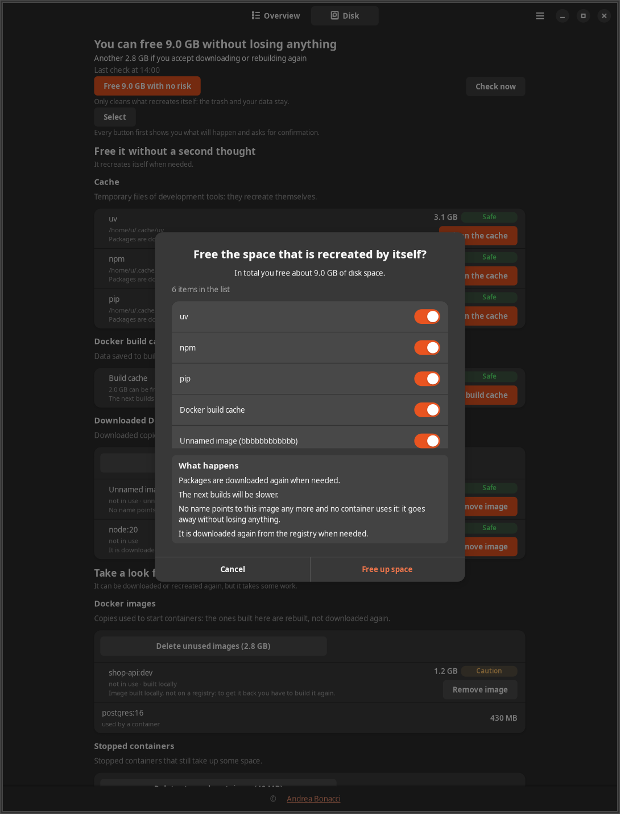

**English** | [Italiano](user-guide.it.md)

# Where Is My Memory: user guide

This guide covers installing the app from a GitHub release, the first start, every part
of the window and the tray icon, and how to remove the app. It refers to version 1.1.0.
The pictures use demo data, not a real computer.

## Contents

- [Requirements](#requirements)
- [Install from a release](#install-from-a-release)
- [First start](#first-start)
- [The Overview tab](#the-overview-tab)
- [The Disk tab](#the-disk-tab)
- [Risk and confirmation](#risk-and-confirmation)
- [Notifications](#notifications)
- [The tray icon](#the-tray-icon)
- [Preferences](#preferences)
- [Command line](#command-line)
- [Questions](#questions)
- [Your files](#your-files)
- [Update and uninstall](#update-and-uninstall)

## Requirements

- Ubuntu 24.04 with the GNOME desktop
- Docker or Podman, only if you want to see and manage containers

## Install from a release

1. Open the [releases page](https://github.com/AndreaBonn/where-is-my-memory/releases/latest)
   and download `where-is-my-memory_1.1.0_all.deb` from the Assets list. The browser saves it
   in `~/Downloads`.

2. Open a terminal and go to that folder:

   ```bash
   cd ~/Downloads
   ```

3. Install the package. `apt` asks for your password and installs the libraries the app
   needs (GTK 4, libadwaita, psutil, the Docker SDK):

   ```bash
   sudo apt install ./where-is-my-memory_1.1.0_all.deb
   ```

   The `./` at the start matters: without it `apt` looks for a package with that name
   online and does not find it.

4. Check that it worked. The command prints the version:

   ```bash
   wimm --version
   ```

`apt` also adds three recommended components: the AppIndicator extension for the tray
icon, the Docker command-line tools and `x11-utils`, which the app uses on X11 to see which
window is in front. The app needs administrator rights only for this installation step, never
while it runs.

## First start

Log out and back in: from then on the app starts by itself at every login, with the icon
in the top bar. If you do not want to log out now, start it from a terminal:

```bash
wimm --background
```

The first time, the window opens on its own with a short welcome message. Later starts
keep the window closed. `wimm` without options opens the window directly, and the app is
also in the application grid as "Where Is My Memory".

For the first few minutes the Overview shows "Collecting data…": the app needs several
samples before it can tell whether something is in use. The first disk check starts two
minutes after launch; you can run it earlier with "Check now" in the Disk tab.

The interface follows the language of your system: Italian on an Italian system, English
otherwise. You can change it in Preferences, under "Language", without restarting.

## The Overview tab



The window has two tabs at the top, Overview and Disk. The Overview opens with a status line
and a panel that sums up what you can free without losing anything, split into memory and
disk, with one button for each:

- "Free … of memory" stops the idle groups rated Safe, named in the line below the button.
- "Free … of disk" cleans what rebuilds itself, such as package caches and Docker build cache.
  The trash and your data stay.
- "Another … if you accept downloading or rebuilding again" counts what costs you a new
  download or build; "See the Disk tab" shows it item by item.

Both buttons open the usual confirmation dialog first, where you can untick single entries.

Below come the memory summary, with a coloured bar by category and a "?" next to the terms
that need an explanation (tmpfs, zram, kernel memory), the video memory of each graphics
card and the disk space.

Then the list of groups. A group is a project, an application, a container or a set of
related processes. Two switches choose what to show: "To free up" (idle groups that have an
action, the default) and "All". "More filters" narrows the list by type and risk, and
`Ctrl+F` searches by name. Each row shows:

- the name, the category (Project, Docker container, Development server, Browser, Terminal
  and so on) and the state: in use, idle for some time, or "activity cannot be measured";
- the reason for that state, for example "You haven't used it for 5 hours.";
- the memory you would get back, the risk badge and the main action button ("Stop",
  "Close…");
- when a group keeps growing, its growth, for example "+620 MB in 2 h". It appears when a
  group grows by at least 256 MB and 20% over at least one hour.

Expanding a row shows its members, each with its own actions, and the row "Don't alert me
about this" with the buttons "1 hour", "1 day", "7 days" and "Never again". Right-click a
row for "Copy command", "Open folder" and "Copy PID".

After you stop something, a message at the bottom reports what was freed. For programs it
also offers "Start again" and "Copy restart command". The copied command is cleared from the
clipboard after 60 seconds.

At the bottom of the list, "System parts" collects the programs the desktop and the system
need. They are listed with the reason they are protected and never have actions: from here
you cannot break anything.

`F5` refreshes the data and `Ctrl+,` opens Preferences.

## The Disk tab



The Disk tab shows what can be freed on the disk, with the time of the last check and the
"Check now" button. The check repeats every 6 hours; you can change the interval in
Preferences.

The entries are grouped in three tiers, one for each risk level, so every row sits with the
others that cost the same to remove:

| Tier | Risk | For example |
|---|---|---|
| Free it without a second thought | Safe | package caches (uv, npm, pip, yarn, pnpm, bun, Cargo, Go, conda), thumbnails, Docker build cache, downloaded Docker images that no container uses |
| Take a look first | Caution | images you built yourself, stopped containers, dependency folders of old projects, caches heavy to download again |
| Caution: deletes data | Danger | Docker volumes, the trash, AI models and emulators |

Each row shows the size, a short risk word and, under the path, a line saying what happens
if you remove it, the same line you will read in the confirmation dialog.

**Dependency folders.** `node_modules`, `.venv`, `venv`, `.tox`, `target`, `.gradle`,
`build`, `.next`, `.nuxt` and `vendor` of projects untouched for more than 90 days. The app
looks for them in your project folders: it picks by itself the folders in your home that
contain git repositories (such as `~/code`, `~/projects`, `~/src`, `~/dev`, `~/git`,
`~/workspace`, `~/Documents`). If it finds none it says so and offers "Choose a folder". You
can add folders in Preferences, under "Advanced settings", "Development folders". A folder
it refuses for safety (a link, a system folder, a network drive, a folder of another user)
is shown there with the reason.

**Models and emulators.** Large caches open into one row per item, each removable on its
own: HuggingFace models, ollama models (also the system ones), Android emulators (AVD) and
SDK packages, Playwright browsers and JetBrains products. Android items are removed through
the Android tools, and JetBrains items keep the IDE settings. While `ollama serve` is
running, a model is removed only through that server.

**Several entries at once.** "Free … with no risk" frees every entry of the first tier in one
dialog. "Select" adds a checkbox to every row; then "Free the selected" frees the ticked
entries together, with each consequence listed in the dialog. After any removal the app
checks the disk again.

Each section shows the 200 largest entries and counts the rest. If Docker is not
available, only the Docker section says so; the rest of the tab works.

On a narrow window the tab becomes a single column:



## Risk and confirmation

Every action carries a badge that says what you risk. The badge always has text, not only
a colour.

| Badge | Meaning | What the app asks |
|---|---|---|
| Safe: you lose nothing | Reversible: no data or work lost; it starts again with the same command. | A dialog with the preview, then a click on the action button, for example "Stop". |
| Caution: you may lose work | Unsaved state, a session or work to redo can be lost (reinstalling dependencies, rebuilding an image). | A dialog with the consequences highlighted and the confirm button in red. |
| Danger: deletes data | Data loss you cannot undo: Docker volumes, the trash, taking down a Compose project with its volumes, force-closing a program with documents or a database. | A dialog that asks you to type the name of the target (the volume, the project, the trash). The button works only when the name matches. |



The risk depends on the pair of item and action: stopping a container that has a volume is
Safe, because the data stays in the volume; removing the volume is Danger. If something
changes between the moment you look and the moment you confirm (a process ended, a
container restarted), the app plans again and shows you the dialog again instead of acting
on a situation you did not see.

Programs are stopped with a normal close signal. If one does not answer within 5 seconds,
the result says so and offers "Force close", a separate action with its own confirmation.
On Firefox, for example, closing this way does not save the session on exit: when it
reopens, the tabs come back from the automatic save, which can be a few seconds behind.

## Notifications

They arrive as GNOME notifications, at most 3 per hour (beyond that they are grouped into
one), in these cases:

- a Project, Docker container, Development server or Development tool group has been idle
  for at least 2 hours and would free at least 200 MB. The notification has the buttons
  "See and decide" and "Not now (24 h)";
- available memory or free disk space falls below 10%, at most once per hour for each kind;
- the system closed one or more programs because memory ran out.

Applications with documents and AI assistants do not send idle notifications unless you
turn them on in Preferences. The window menu also has "Mute for 1 h".

## The tray icon

A left click opens the window, or brings it to the front if it is already open. A right
click opens a menu with, in this order:

- "Open Where Is My Memory";
- the memory in use, for example "Memory used: 48%";
- the disk, for example "Disk: 87% used (9.0 GB can be freed safely)";
- "To free up:" and up to 5 idle groups with their size; a click opens the window on that
  group;
- "Mute notifications for 1 h" (or the time the mute ends);
- "Quit".

Next to the icon a label such as "4.2 GB to free up" shows the memory you would get back by
stopping what is not in use. Below 100 MB the label is hidden. Hovering the icon shows
memory and disk in use.

The icon is a memory chip in the colour of the bar, with no colours of its own. Its drawing
follows the scarcer resource between available memory and free disk space:

| Icon | Looks like | Meaning |
|---|---|---|
| Normal | empty chip | both above 15% |
| Warning | chip with an exclamation mark | the scarcer one is below 15%, or the system is under memory pressure |
| Critical | filled chip with an exclamation mark | the scarcer one is below 10%, or the memory pressure is severe |

The two limits can be changed in Preferences. The icon also turns to warning if monitoring
fails for 3 cycles in a row, and then the first menu entry says so.

Closing the window does not stop the app, which keeps watching. To quit completely use
"Quit" in the icon menu or in the window menu.

## Preferences

Open them from the window menu or with `Ctrl+,`.

- "How many alerts do you want?" picks a preset that sets the idle time, the size and the
  number of notifications per hour: "Few" (4 hours, 500 MB, 1 per hour), "Normal" (2 hours,
  200 MB, 3 per hour) or "Many" (1 hour, 100 MB, 6 per hour).
- "Language" switches between Italiano and English at once.
- "Programs without alerts" lists what you set to "Never again", so you can turn alerts
  back on.
- "Advanced settings" holds every threshold one by one: notification limits, the icon
  limits, the seconds before "Force close" is offered, the disk check interval, the age and
  depth of dependency folders, the development folders, and the "Closing programs" group.
- "Restore the recommended values" brings everything back to the defaults.

## Command line

| Command | What it does |
|---|---|
| `wimm` | opens the window |
| `wimm --background` | starts with the icon only, as the autostart does |
| `wimm --version` | prints the version |
| `wimm status` | prints memory, memory pressure, the 5 largest groups and free disk space, then exits |
| `wimm status --json` | the same in JSON |

`wimm status` asks the running app for its data, or takes one sample if the app is not
running. It also works from an SSH session.

## Questions

**I cannot see the icon in the top bar.**
On Ubuntu the icon depends on the GNOME AppIndicator extension. If it is off or missing, the
app still works: about 10 seconds after start it opens the window, even with
`--background`, with a notice at the top. "How to turn it on" shows the steps for your
system. On Ubuntu:

```bash
gnome-extensions enable ubuntu-appindicators@ubuntu.com
```

If the extension is not installed, install `gnome-shell-extension-appindicator` with `apt`.
When the icon appears, the notice goes away.

**Why does the browser show "activity cannot be measured"?**
From outside you cannot tell whether a Firefox or Chrome tab is in use: the browser does not
expose it. For browsers, applications with a window and terminals the app checks whether
their window was in front recently. The browser memory is counted and shown, but for the
whole browser, not tab by tab.

**On Ubuntu 24.04 many apps show "activity cannot be measured". Why?**
Ubuntu 24.04 uses Wayland by default, and on Wayland a program cannot see which window is in
front. Development servers, containers and development tools are judged by CPU and network
and work on Wayland too. For the rest there are two options:

- choose "Ubuntu on Xorg" on the login screen;
- turn on the small GNOME extension that comes with the package (GNOME 46). It tells the app
  which program is in front and nothing else. It is experimental and the app never turns it
  on by itself. Log out and back in after installing the app, then run:

  ```bash
  gnome-extensions enable wimm-focus@wimm.github.io
  ```

**A server started in the VS Code terminal is not listed among development servers. Why?**
By design, everything started from VS Code counts inside the editor group. A server launched
from the integrated terminal has no group of its own, but its memory is included in VS
Code's. Launched from a normal terminal, it shows up on its own.

**Programs started over SSH show up as system parts. Why?**
To be careful, processes started from an SSH session, or from a tmux started there, are
protected by default and appear under "System parts". To manage them like the others, turn
on "Also manage programs started over SSH" in Preferences, "Advanced settings", "Closing
programs". The SSH server and the login shell stay protected anyway.

**Does it help with what I run on other machines over a remote connection?**
No. The app looks only at the computer it is installed on. What runs on a remote server uses
that server's memory, not yours.

**What does the app never do?**
It never asks for or uses administrator rights (`sudo`). It never force-closes a program by
itself: "Force close" runs only if you pick it after a failed attempt, with its own
confirmation. It deletes or stops nothing without your confirmation in the dialog, not even
the actions rated Safe. Desktop and system processes are protected and have no actions. It
acts only on the processes and containers of your user. On the disk it deletes only what the
Disk tab lists: dependency folders, the content of package caches and of the trash, single
models and emulators, and Docker images, stopped containers, volumes and build cache. It
never touches the code or the other files of your projects.

## Your files

The app saves only its own data, in the standard user folders:

| Folder | Content |
|---|---|
| `~/.config/where-is-my-memory/` | the preferences (`config.json`) |
| `~/.local/state/where-is-my-memory/` | window size, how long each group has been idle, muted and ignored groups, the log `wimm.log` |
| `~/.cache/where-is-my-memory/` | data the app can rebuild, such as the sizes of scanned folders |

## Update and uninstall

To update, download the new `.deb` from the releases page and install it with the same
command as in [Install from a release](#install-from-a-release). Your preferences stay.

To uninstall, choose "Quit" in the icon menu first (`apt` does not stop the app), then:

```bash
sudo apt remove where-is-my-memory
```

Your files in the three folders above stay, with `apt remove` and with `apt purge`, because
they are your data: delete the folders by hand if you want them gone. `apt remove` leaves the
autostart file in `/etc/xdg/autostart/`, as for any system configuration file;
`sudo apt purge where-is-my-memory` removes that too. The libraries installed with the app
stay; `sudo apt autoremove` removes those no other program uses.
